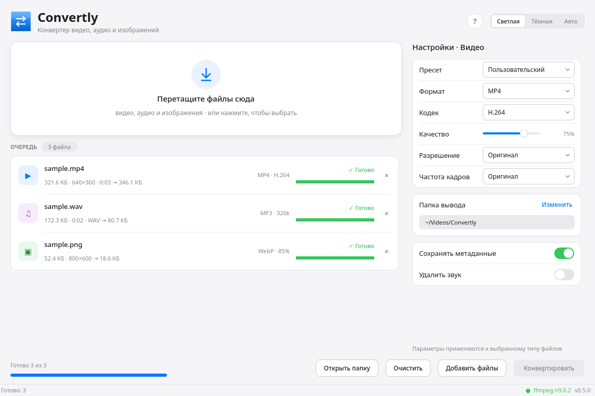
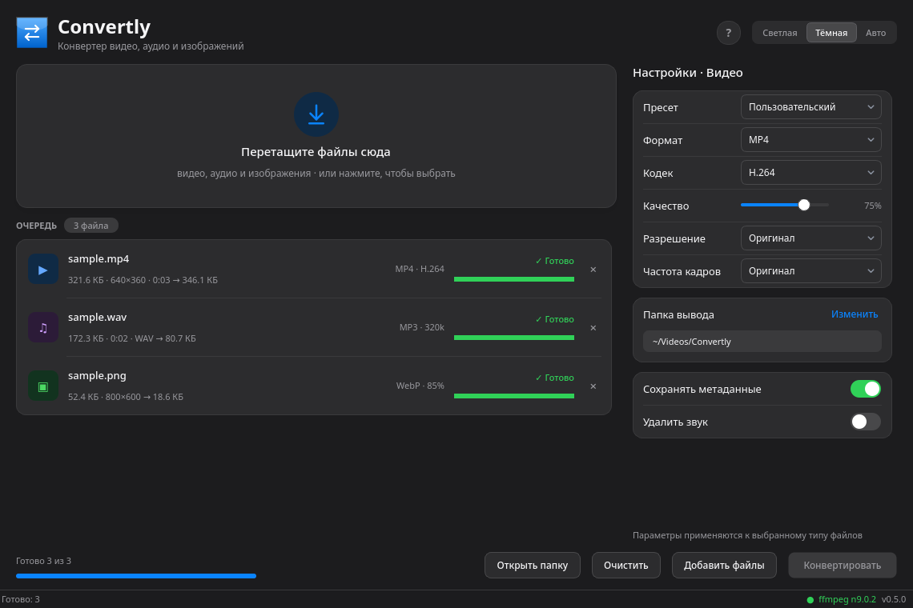

# Convertly

Десктопный конвертер видео, аудио и изображений.
Работает через `ffmpeg`, интерфейс на PySide6 (Qt 6).

| Светлая тема | Тёмная тема |
|---|---|
|  |  |

## Возможности

- Перетаскивание файлов и папок в окно или выбор через диалог
- Пакетная очередь: несколько файлов параллельно (по 2 за раз)
- Прогресс в процентах и скорость, отмена, повторный запуск
- Удаление отдельных файлов из очереди
- Клик по имени готового файла открывает папку с ним в файловом менеджере
- Итоговый размер показывается рядом с исходным («было → стало»)
- Уведомление о завершении в системном трее, если окно не в фокусе
- Настройки автоматически переключаются под тип файла; клик по строке очереди показывает настройки её типа
- Пресеты: Telegram 1080p, WebM 720p, MP3 320, FLAC, WebP 80%, JPEG 90%
- Выбор кодека только из тех, что реально есть в установленном ffmpeg
- Ресайз, частота кадров, сохранение метаданных, удаление звука
- Темы: светлая, тёмная и «Авто» (следует за системной)
- Справка по кнопке «?» или F1: горячие клавиши, форматы, частые вопросы

## Горячие клавиши

| Клавиши | Действие |
|---------|----------|
| `Ctrl + O` | Добавить файлы |
| `Ctrl + Enter` | Запустить или остановить конвертацию |
| `Ctrl + L` | Открыть папку вывода |
| `F1` | Справка |
| `Ctrl + Q` | Закрыть приложение |

## Установка

### Windows

**Готовый архив.** Скачайте `Convertly-windows-x64.zip` со страницы
[Releases](../../releases) и распакуйте в любую папку. Запуск — `Convertly.exe`.
Python и ffmpeg ставить не нужно, они уже внутри.

При первом запуске Windows может показать SmartScreen («неизвестный издатель»):
выберите «Подробнее» → «Выполнить в любом случае». Сборка не подписана.

**Вручную из исходников.** Нужны Python 3.10+ и ffmpeg:

1. Установите Python с [python.org](https://www.python.org/downloads/windows/),
   отметив «Add python.exe to PATH».
2. Установите ffmpeg: `winget install Gyan.FFmpeg` (после установки откройте новый терминал).
3. В папке проекта выполните в PowerShell:

```powershell
py -m venv .venv
.\.venv\Scripts\Activate.ps1
pip install .
convertly
```

Если PowerShell запрещает активацию, запустите напрямую:

```powershell
.\.venv\Scripts\convertly.exe
```

Без установки, прямо из папки: `run.bat` или `run.ps1`.

### Linux

```bash
sudo pacman -S python pyside6 ffmpeg
pipx install .
convertly
```

Без установки: `./run.sh` (или `PYTHONPATH=src python3 -m convertly`).

Ярлык в меню KDE:

```bash
install -Dm644 packaging/convertly.desktop ~/.local/share/applications/convertly.desktop
install -Dm644 packaging/convertly.svg ~/.local/share/icons/hicolor/scalable/apps/convertly.svg
```

### macOS

```bash
brew install python ffmpeg
pipx install .
convertly
```

Готовой `.app`-сборки пока нет, запуск через терминал.

## Что поддерживается

| Тип | Вход | Выход |
|-----|------|-------|
| Видео | mp4, mkv, webm, mov, avi, m4v, ts, flv, wmv, mpg, 3gp, ogv | MP4, MKV, WebM, MOV |
| Аудио | mp3, flac, wav, ogg, opus, aac, m4a, wma, aiff | MP3, FLAC, WAV, OGG |
| Изображения | png, jpg, webp, bmp, tif, gif, heic, avif | JPEG, PNG, WebP |

Кодеки видео: H.264, H.265, VP9, AV1 — если энкодер есть в ffmpeg.
Для WebM звук перекодируется в Opus, для MP4/MOV — в AAC.

## Настройки

Файл конфигурации:

- Linux — `~/.config/convertly/config.json`
- Windows — `%APPDATA%\Convertly\config.json`
- macOS — `~/Library/Application Support/Convertly/config.json`

Хранит папку вывода, параметры для каждого типа, тему и размер окна.
Удаление файла возвращает настройки по умолчанию.

Результат по умолчанию сохраняется в `~/Videos/Convertly`
(на macOS — `~/Movies/Convertly`).

## Тесты

```bash
python3 -m venv .venv
.venv/bin/pip install -e ".[dev]"
.venv/bin/pytest
```

Тесты используют `ffmpeg` для создания тестовых файлов и пропускаются, если его нет.
Те же тесты запускаются в GitHub Actions на Linux, Windows и macOS.

## Сборка релиза

В репозитории есть спецификация PyInstaller и CI-процесс:

```bash
pip install pyinstaller
pyinstaller packaging/convertly.spec
```

Перед сборкой положите `ffmpeg` и `ffprobe` в папку `vendor/` — они попадут внутрь
дистрибутива. При пуше тега `v*` GitHub Actions собирает архивы для Linux и Windows
и публикует их в Releases.

## Ограничения

- Конвертация только целиком: обрезки по времени пока нет
- GIF и анимированные WebP конвертируются по первому кадру
- Из нескольких аудиодорожек берётся первая
- Аппаратное ускорение (NVENC/VAAPI) пока не используется

## Структура

```
convertly/
├── pyproject.toml
├── src/convertly/
│   ├── __init__.py              # версия
│   ├── __main__.py              # точка входа
│   ├── config.py                # настройки и пути под каждую ОС
│   ├── core/
│   │   ├── binaries.py          # поиск ffmpeg/ffprobe
│   │   ├── probe.py             # ffprobe → тип, кодеки, длительность
│   │   ├── prober.py            # фоновое чтение файлов
│   │   ├── capabilities.py      # энкодеры ffmpeg
│   │   ├── formats.py           # форматы и кодеки
│   │   ├── command.py           # настройки → аргументы ffmpeg
│   │   ├── reveal.py            # показать файл в проводнике
│   │   └── runner.py            # QProcess, очередь, прогресс, отмена
│   └── ui/
│       ├── theme.py             # светлая и тёмная темы
│       ├── main_window.py       # окно и логика очереди
│       ├── help_dialog.py       # справка
│       ├── assets/              # svg-иконки
│       └── widgets/
│           ├── drop_zone.py
│           ├── queue_view.py
│           ├── segmented.py
│           └── settings_panel.py
├── tests/
├── packaging/
│   ├── convertly.spec           # сборка PyInstaller
│   ├── convertly.desktop
│   ├── convertly.ico
│   └── convertly.svg
├── .github/workflows/           # тесты и релизы
├── docs/
├── run.sh / run.ps1 / run.bat
├── LICENSE
└── README.md
```

## Лицензия

Код распространяется по MIT — см. `LICENSE`.
Иконки интерфейса и логотип используют пути из набора [Lucide](https://lucide.dev)
под лицензией ISC — см. `THIRD_PARTY_NOTICES.md`.

В релизные архивы входит сборка FFmpeg под GPL (H.264/H.265).
Текст лицензии и ссылки на исходники — `packaging/FFMPEG_NOTICE.txt`.
